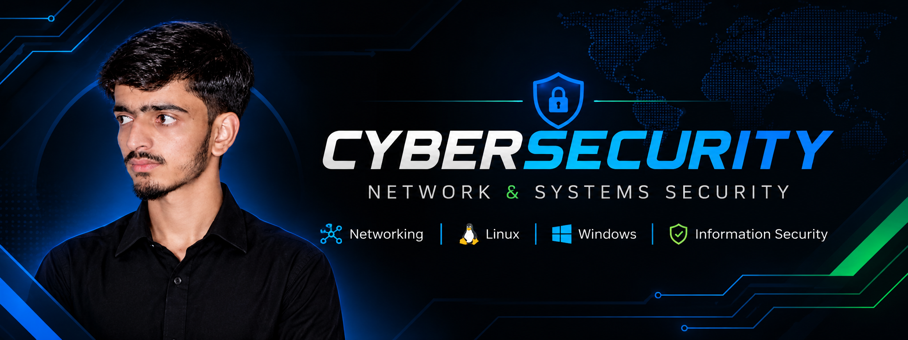

# Junaid Bilal | Cybersecurity

  

<h3 align="center">Network & Systems Security | SOC Operations | Web Application Security</h3>

---

## About Me

I'm focused on developing practical cybersecurity skills across defensive security and offensive security.

- Network Security and Networking Fundamentals
- Linux and Windows Systems
- SOC Operations and Security Monitoring
- Web Application Security and Bug Bounty Hunting

## Technical Knowledge

- **Networking:** IPv4, IPv6, IP Addressing, CCNA Fundamentals, ACLs
- **Operating Systems:** Linux, Windows
- **Cybersecurity:** Network Security, Web Security Fundamentals, Security Monitoring

## Areas of Interest

- **Blue Team:** Log Analysis, Threat Detection, Incident Response, SOC Operations
- **Web Security:** SQL Injection, Cross-Site Scripting (XSS), Authentication Security, Vulnerability Assessment

## Current Focus

Building hands-on experience through practical labs, security research, and technical projects.
## Certifications

### Google Cybersecurity Professional Certificate
- **Provider:** Google
- **Platform:** Coursera
- **Focus:** Cybersecurity, Network Security, Linux, SIEM, Threat Detection and Incident Response
- **Certificate:** [View Credential](https://coursera.org/share/36eae62d4f2f598795e545dc0fb722ce)

## Connect With Me

GitHub: [@junaidbilal-infosec](https://github.com/junaidbilal-infosec)

---

*Learn • Practice • Analyze • Secure*
